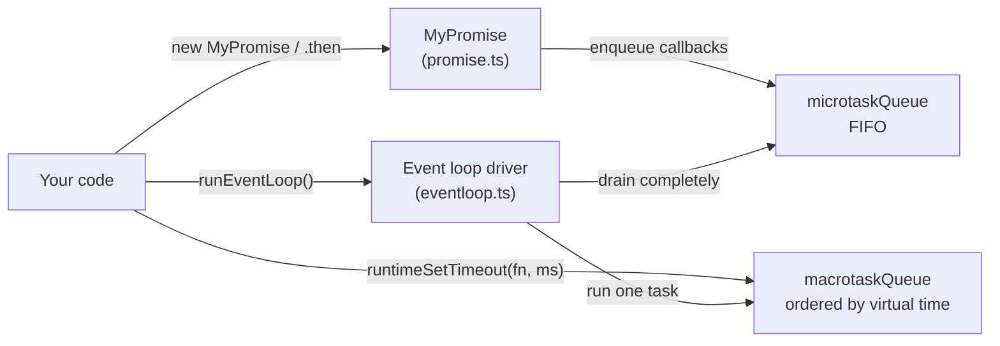
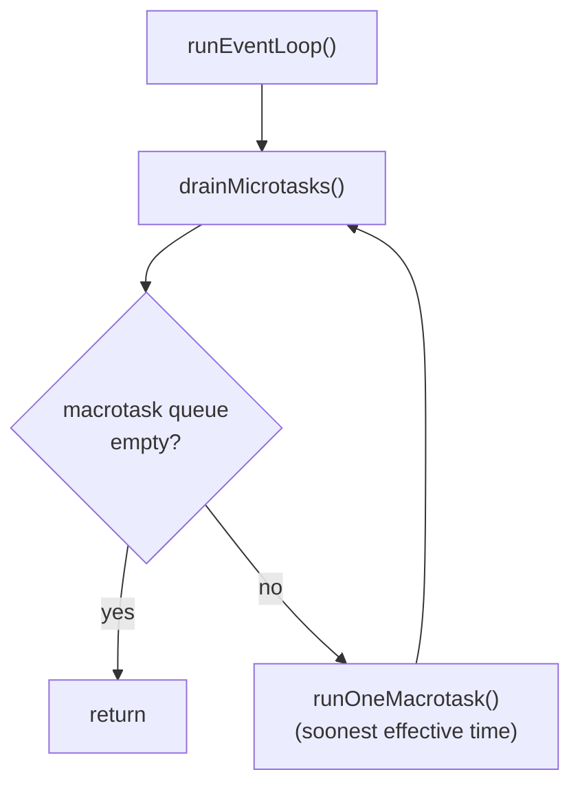
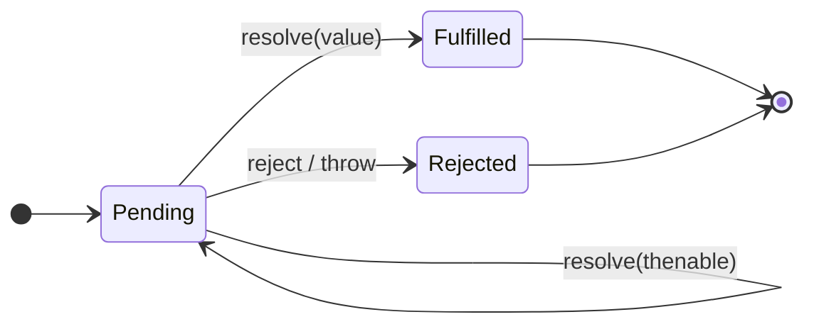
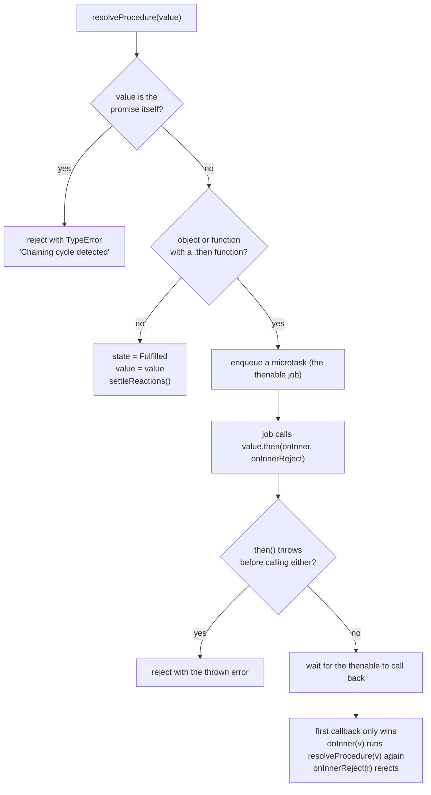
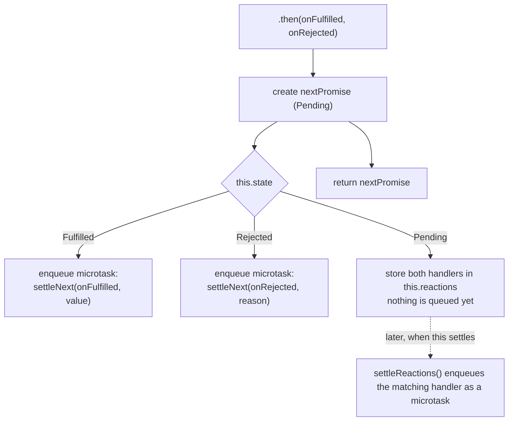
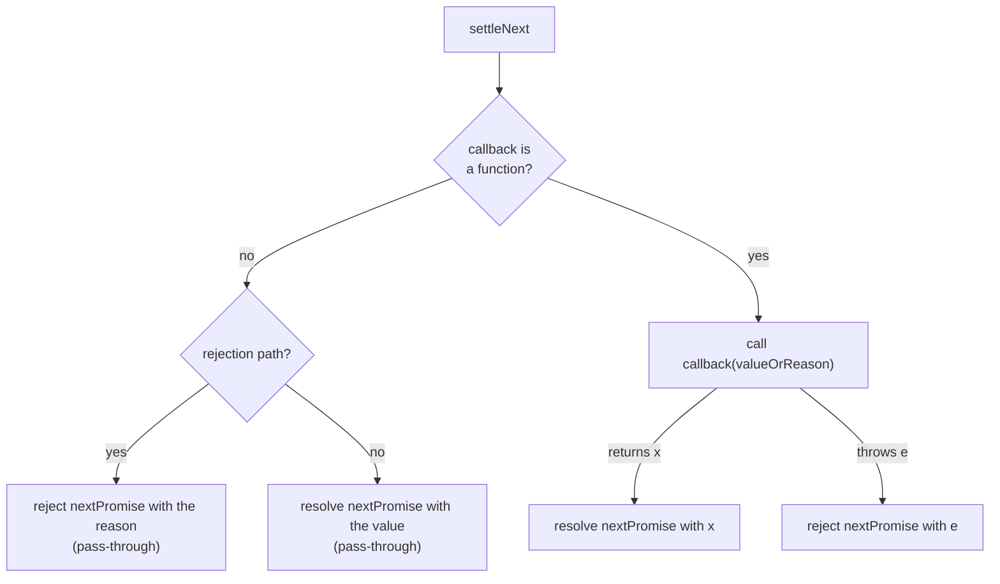

# promise-eventloop — Developer Guide

This guide explains how the library works inside, follows complete executions step by step, and shows how to use it. If you only want the big picture, read the [Overview](./overview.md) first.

**Contents**

1. [Architecture](#1-architecture)
2. [The event loop](#2-the-event-loop-srceventloopts)
3. [MyPromise](#3-mypromise-srcpromisets)
4. [Walkthroughs: the flow of operations](#4-walkthroughs-the-flow-of-operations)
5. [Using the library: examples](#5-using-the-library-examples)
6. [Tests](#6-tests)
7. [Differences from native Promise and known limitations](#7-differences-from-native-promise-and-known-limitations)
8. [Extending the library](#8-extending-the-library)

---

## 1. Architecture

Two modules, one direction of dependency: `promise.ts` imports the microtask queue from `eventloop.ts`, and `eventloop.ts` knows nothing about promises.



Nothing runs by itself. Registering a callback only puts a task in a queue; tasks execute when you call `runEventLoop()`.

---

## 2. The event loop (`src/eventloop.ts`)

### 2.1 Two queues

| Queue | Holds | Order |
|---|---|---|
| `microtaskQueue` | Promise callbacks and internal promise jobs | Strict FIFO |
| `macrotaskQueue` | Timer callbacks (`runtimeSetTimeout`) | Soonest **effective time** first; ties go to whichever was registered first |

### 2.2 The virtual clock

The macrotask queue keeps a virtual clock, `currentTime`, that starts at 0. It never reads the real time.

- When you register a timer, its **effective time** is `currentTime + delay` (a negative delay counts as 0).
- When a timer is taken off the queue, `currentTime` jumps to that timer's effective time.

Two consequences:

- A timer registered from inside another timer is relative to *that timer's* time. A 5 ms timer that registers a 0 ms timer produces a task at time 5, which beats a separate timer at time 7.
- Nothing ever waits. A 100 ms timer fires immediately once the loop reaches it.

Call `resetEventLoop()` to empty both queues and reset the clock to 0. It is the right thing to do between tests, because the queues are module-level singletons.

### 2.3 Running the loop



`drainMicrotasks()` keeps taking tasks until the queue is empty and checks `isEmpty()` on every iteration. It does not snapshot the length first, so microtasks queued *by* a running microtask (for example the next `.then` in a chain) run in the same drain.

### 2.4 Errors inside tasks

Every task runs inside `runTask`, which catches anything it throws and logs it with `console.error("Uncaught error in queued task:", err)`. One bad callback cannot stop the loop. Promise callbacks do not normally reach this handler, because `MyPromise` catches their errors itself and turns them into rejections.

### 2.5 API reference

| Export | Purpose |
|---|---|
| `runtimeSetTimeout(callback, delay = 0)` | Register a macrotask `delay` virtual time units from now. |
| `runEventLoop()` | Drain microtasks, then repeat "run one macrotask, drain microtasks" until both queues are empty. Can be called again later. |
| `drainMicrotasks()` | Run microtasks until the microtask queue is empty. |
| `runOneMacrotask()` | Run exactly one macrotask. Does not drain microtasks afterwards. |
| `resetEventLoop()` | Empty both queues and reset the virtual clock. |
| `microtaskQueue`, `macrotaskQueue` | The queue singletons: `enqueue`, `dequeue`, `isEmpty`, `size`, `reset` (the microtask queue also has `getTask(index)`). |

`drainMicrotasks`, `runOneMacrotask` and `runEventLoop` are separate on purpose, so you can step the loop one macrotask at a time and inspect the queues in between.

---

## 3. MyPromise (`src/promise.ts`)

### 3.1 State and fields



`resolve(thenable)` is the self-loop: the promise is locked against further `resolve`/`reject` calls but stays `Pending` while it follows the thenable (see 3.3).

| Field | Meaning |
|---|---|
| `state` | `"Pending"`, `"Fulfilled"` or `"Rejected"` |
| `value` | The result, once fulfilled |
| `reason` | The error, once rejected |
| `reactions` | Handlers registered with `.then` while the promise was still pending |
| `instance` | A numeric id, handy when reading logs |
| `locked` (private) | Set the first time `resolve` or `reject` is called, so later calls are ignored |

### 3.2 Construction

`new MyPromise(executor)` runs the executor **synchronously**, passing it bound `resolve` and `reject` functions. If the executor throws, the error is passed to `reject`. If the promise was already resolved, that throw is ignored, as it is for native promises.

### 3.3 Settling a promise

`resolve(value)` and `reject(reason)` both begin with the same guard:

```ts
if (this.locked || this.state != "Pending") return;
this.locked = true;
```

The lock matters because a promise resolved with another promise stays `Pending` while it follows it. Checking `state` alone would let a later `reject()` slip through during that window.

After the guard, `resolve` hands the value to the **resolution procedure**:



Details worth knowing:

- **Adoption is deferred to a microtask.** Calling `value.then(...)` right away would be a tick too early. Native promises defer it, and so does `MyPromise`, so the two agree on ordering.
- **A first-call-wins flag** (`called`) protects against thenables that call their callbacks more than once, or throw after calling one.
- **`onInner` re-enters `resolveProcedure`**, not `resolve`, so nested thenables are unwrapped to any depth without being blocked by the lock.
- **Rejecting never unwraps.** `reject(somePromise)` rejects with the promise object itself, as native does.

### 3.4 `.then(onFulfilled, onRejected)`

`then` always returns a **new** promise, `nextPromise`. It decides what to do based on the current state:



`settleNext(callback, valueOrReason, isRejectionPath)` is what a queued task actually runs:



Three rules fall out of this:

1. **A handler that returns normally always fulfils the next promise**, even a rejection handler. That is how a chain recovers from an error.
2. **A missing handler is a pass-through.** `p.then(undefined, onRejected)` leaves fulfilled values untouched, and `p.then(onFulfilled)` leaves rejections untouched.
3. **Returned values go through `resolve`.** Returning a promise from a handler therefore makes the next promise follow it, and returning `nextPromise` itself is rejected as a cycle.

### 3.5 `settleReactions()`

When a promise settles, `settleReactions()` walks `reactions` in the order they were registered, queues the matching handler of each one as a microtask, and clears the list. That is why several `.then` calls on one promise run in registration order.

---

## 4. Walkthroughs: the flow of operations

The traces below were captured from real runs: every `enqueue` and `run` line is printed by instrumenting the two queues. The annotations are explanations.

### 4.1 A single `.then` on an already-resolved promise

```ts
const p = new MyPromise((resolve) => resolve(42));
p.then((value) => console.info("callback got", value));
runEventLoop();
```

```text
--- sync phase
  enqueue microtask #1   (microtask queue size: 1)
--- runEventLoop()
run microtask #1
  callback got 42
```

1. The executor runs immediately and calls `resolve(42)`. 42 is not a thenable, so `p` becomes `Fulfilled` at once. No reactions exist yet, so no microtask is queued.
2. `p.then(cb)` finds `p` already `Fulfilled`, so it queues **microtask #1**. The callback has not run.
3. `runEventLoop()` drains the queue: microtask #1 runs `cb(42)`.

### 4.2 A pending promise settled by a timer

```ts
const delay = (ms, v) =>
  new MyPromise((resolve) => runtimeSetTimeout(() => resolve(v), ms));

delay(50, "A")
  .then((a) => { console.info("first:", a); return delay(20, a + "B"); })
  .then((ab) => console.info("second:", ab));
```

```text
--- sync phase
  enqueue macrotask #1   (delay 50)
--- runEventLoop()
run macrotask #1
  enqueue microtask #1   (microtask queue size: 1)
run microtask #1
  >> first: A
  enqueue macrotask #2   (delay 20)
  enqueue microtask #2   (microtask queue size: 1)
run microtask #2
run macrotask #2
  enqueue microtask #3   (microtask queue size: 1)
run microtask #3
  enqueue microtask #4   (microtask queue size: 1)
run microtask #4
  >> second: AB
```

| Step | What happens |
|---|---|
| Sync phase | `delay(50, "A")` registers **macrotask #1** (effective time 50). The promise is `Pending`, so both `.then` calls only store their handlers in `reactions`. Nothing is queued in the microtask queue. |
| Macrotask #1 runs | Its `resolve("A")` fulfils the promise and `settleReactions()` queues **microtask #1**, the first `.then` callback. |
| Microtask #1 | Prints `first: A`. It calls `delay(20, ...)`, which registers **macrotask #2** at time 50 + 20 = 70. The callback returns that promise, so the outer promise is resolved with a thenable and queues **microtask #2**, the thenable job. |
| Microtask #2 | The job calls `.then` on the inner promise. It is still pending, so the job's handlers are stored as reactions. Nothing else to run. |
| Macrotask #2 runs | `resolve("AB")` fulfils the inner promise. `settleReactions()` queues **microtask #3**. |
| Microtask #3 | Hands `"AB"` to the outer promise's resolution procedure. It is a plain value, so the outer promise is fulfilled and **microtask #4**, the second `.then` callback, is queued. |
| Microtask #4 | Prints `second: AB`. Both queues are empty, so the loop returns. |

### 4.3 Returning a promise from `.then` costs extra ticks

```ts
const resolved = (v) => new MyPromise((resolve) => resolve(v));

// Chain A returns a promise from its first .then
resolved().then(() => resolved("A")).then(() => console.info("chain A done"));

// Chain B is a plain chain
resolved().then(() => console.info("t1"))
          .then(() => console.info("t2"))
          .then(() => console.info("t3"))
          .then(() => console.info("t4"));
```

```text
--- sync phase
  enqueue microtask #1   (microtask queue size: 1)
  enqueue microtask #2   (microtask queue size: 2)
--- runEventLoop()
run microtask #1
  enqueue microtask #3   (microtask queue size: 2)
run microtask #2
  >> t1
  enqueue microtask #4   (microtask queue size: 2)
run microtask #3
  enqueue microtask #5   (microtask queue size: 2)
run microtask #4
  >> t2
  enqueue microtask #6   (microtask queue size: 2)
run microtask #5
  enqueue microtask #7   (microtask queue size: 2)
run microtask #6
  >> t3
  enqueue microtask #8   (microtask queue size: 2)
run microtask #7
  >> chain A done
run microtask #8
  >> t4
```

| Task | Chain | What it does |
|---|---|---|
| #1 | A | Runs the first callback. It returns a promise, so the next promise is resolved with a thenable and queues #3 (the thenable job). |
| #2 | B | Prints `t1`, fulfils the next promise, queues #4. |
| #3 | A | The thenable job calls `.then` on the returned promise. It is already fulfilled, so this queues #5. |
| #4 | B | Prints `t2`, queues #6. |
| #5 | A | Applies `"A"` to the next promise, which becomes fulfilled and queues #7. |
| #6 | B | Prints `t3`, queues #8. |
| #7 | A | Prints `chain A done`. |
| #8 | B | Prints `t4`. |

Returning a promise costs **two extra ticks** (the thenable job, then the reaction on the returned promise), so chain A finishes after `t3` and before `t4`. This is the same order native Promises produce, which is why the library defers the `value.then(...)` call instead of making it immediately.

### 4.4 Rejection, pass-through and recovery

```ts
new MyPromise((_resolve, reject) => reject("disk full"))
  .then((v) => console.info("skipped", v))        // no onRejected: the reason passes through
  .then(undefined, (reason) => { /* handles it */ return "default value"; })
  .then((v) => console.info("continuing with:", v));
```

1. The first promise is `Rejected` at once.
2. The first `.then` has no `onRejected`, so `settleNext` takes the pass-through branch and rejects the next promise with the same reason. The success callback never runs.
3. The second `.then` has an `onRejected`. It runs and **returns normally**, so the next promise is *fulfilled* with `"default value"`.
4. The third `.then` therefore sees a fulfilled value and the chain continues normally.

If a callback throws instead of returning, `settleNext` catches the throw and rejects the next promise with it, so the error keeps travelling down the chain.

### 4.5 Microtasks before macrotasks

```ts
runtimeSetTimeout(() => console.info("3: timer (macrotask)"), 0);
new MyPromise((resolve) => resolve(undefined)).then(() => console.info("2: promise callback (microtask)"));
console.info("1: synchronous code");
runEventLoop();
```

The timer is registered first, but it sits in the macrotask queue. The loop always drains the microtask queue before it takes a macrotask, so the output is `1`, `2`, `3`. The full runnable version is [example 4](#example-4-microtasks-before-macrotasks-virtual-time).

---

## 5. Using the library: examples

Every example below was run against the current code, and the output shown is the real output.

**To run an example**, save it as `examples/<name>.ts` in the project root and run:

```bash
npx tsx examples/<name>.ts
```

(`tsx` is not a project dependency; `npx` fetches it on first use. You can also paste an example into a Vitest test.)

Each example starts with `console.log = () => {};`. `MyPromise.then` and the event loop print tracing through `console.log`, so silencing it keeps the output readable. The examples print their results with `console.info`.

Imports use `../src/...` because the examples live in `examples/`.

### Example 1: The basics

A promise is settled by calling `resolve` (or `reject`) from the executor. `.then` registers a callback, and nothing runs until the loop does.

```ts
import { MyPromise } from "../src/promise";
import { runEventLoop } from "../src/eventloop";

console.log = () => {}; // silence the library's tracing; we print with console.info

const p = new MyPromise((resolve) => resolve(42));
p.then((value) => console.info("got", value));

console.info("sync code finished");
runEventLoop(); // nothing runs until you start the loop
```

Output:

```text
sync code finished
got 42
```

`sync code finished` is printed before `got 42` even though the promise was already resolved. Callbacks always wait for the loop.

### Example 2: Chaining and transforming values

Each `.then` returns a new promise that holds the callback's return value.

```ts
import { MyPromise } from "../src/promise";
import { runEventLoop } from "../src/eventloop";

console.log = () => {};

new MyPromise((resolve) => resolve(2))
  .then((n) => n * 10)
  .then((n) => n + 1)
  .then((n) => console.info("result:", n));

runEventLoop();
```

Output:

```text
result: 21
```

### Example 3: Errors, pass-through and recovery

```ts
import { MyPromise } from "../src/promise";
import { runEventLoop } from "../src/eventloop";

console.log = () => {};

// 1. A rejection skips .then() calls that have no rejection handler,
//    until something handles it. Returning a value recovers the chain.
new MyPromise((_resolve, reject) => reject("disk full"))
  .then((v) => console.info("skipped", v))
  .then(undefined, (reason) => {
    console.info("recovered from:", reason);
    return "default value";
  })
  .then((v) => console.info("continuing with:", v));
runEventLoop();

// 2. A throw inside a callback becomes a rejection of the next promise.
new MyPromise((resolve) => resolve(1))
  .then(() => {
    throw new Error("boom");
  })
  .then(undefined, (e) => console.info("caught:", e.message));
runEventLoop();
```

Output:

```text
recovered from: disk full
continuing with: default value
caught: boom
```

- The first `.then` has no rejection handler, so `"disk full"` flows past it.
- The second `.then` handles it and returns a value, which recovers the chain.
- In the second block, a thrown `Error` inside a callback becomes a rejection of the next promise.

### Example 4: Microtasks before macrotasks, virtual time

```ts
import { MyPromise } from "../src/promise";
import { runEventLoop, runtimeSetTimeout } from "../src/eventloop";

console.log = () => {};

// Registered first, but a timer is a macrotask: it waits for all microtasks.
runtimeSetTimeout(() => console.info("3: timer (macrotask)"), 0);

new MyPromise((resolve) => resolve(undefined)).then(() =>
  console.info("2: promise callback (microtask)")
);

console.info("1: synchronous code");
runEventLoop();

// Timers run in order of their delay, not the order they were registered.
runtimeSetTimeout(() => console.info("slow timer, 100 ms"), 100);
runtimeSetTimeout(() => console.info("fast timer, 10 ms"), 10);
runEventLoop(); // finishes instantly: the clock is virtual, nothing really waits
```

Output:

```text
1: synchronous code
2: promise callback (microtask)
3: timer (macrotask)
fast timer, 10 ms
slow timer, 100 ms
```

- A promise callback (microtask) runs before a timer (macrotask), even though the timer was registered first.
- Timers fire in order of delay, so the 10 ms timer beats the 100 ms timer.
- It finishes instantly. The clock is virtual, so nothing waits.

### Example 5: Turning a timer into a promise

A `delay` helper is the usual way to bring timers into promise code.

```ts
import { MyPromise } from "../src/promise";
import { runEventLoop, runtimeSetTimeout } from "../src/eventloop";

console.log = () => {};

// Turn the callback-style timer into a promise.
const delay = (ms: number, value: unknown) =>
  new MyPromise((resolve) => runtimeSetTimeout(() => resolve(value), ms));

delay(50, "A")
  .then((a) => {
    console.info("first:", a);
    return delay(20, a + "B"); // returning a promise: the chain waits for it
  })
  .then((ab) => console.info("second:", ab));

delay(30, "other").then((v) => console.info("independent:", v));

runEventLoop();
```

Output:

```text
independent: other
first: A
second: AB
```

The `independent` chain finishes first because its timer is due at virtual time 30, before the first chain's at 50. The `second` step lands at 50 + 20 = 70. Returning `delay(20, ...)` from a callback makes the chain wait for it.

### Example 6: Returning a promise from `.then`

```ts
import { MyPromise } from "../src/promise";
import { runEventLoop, runtimeSetTimeout } from "../src/eventloop";

console.log = () => {};

const resolved = (v?: unknown) => new MyPromise((resolve) => resolve(v));

// Chain A returns a promise from its first .then; chain B is a plain chain.
resolved()
  .then(() => resolved("A"))
  .then(() => console.info("chain A done"));

resolved()
  .then(() => console.info("t1"))
  .then(() => console.info("t2"))
  .then(() => console.info("t3"))
  .then(() => console.info("t4"));

runEventLoop();

// Returning a promise that is still pending: the chain waits for it.
const slow = new MyPromise((resolve) =>
  runtimeSetTimeout(() => resolve("slow result"), 100)
);
resolved()
  .then(() => slow)
  .then((v) => console.info("adopted:", v));
runEventLoop();
```

Output:

```text
t1
t2
t3
chain A done
t4
adopted: slow result
```

- The first block shows the extra ticks explained in [walkthrough 4.3](#43-returning-a-promise-from-then-costs-extra-ticks).
- The second block returns a promise that is still pending; the chain waits for the timer and then continues with its value.

### Example 7: A promise settles once

```ts
import { MyPromise } from "../src/promise";
import { runEventLoop } from "../src/eventloop";

console.log = () => {};

// 1. A promise settles once. Later resolve/reject calls are ignored.
new MyPromise((resolve, reject) => {
  resolve("first");
  resolve("second");
  reject("ignored");
}).then(
  (v) => console.info("value:", v),
  (e) => console.info("error:", e)
);

// 2. A promise cannot be resolved with itself.
let resolveSelf!: (value: unknown) => void;
const p = new MyPromise((resolve) => {
  resolveSelf = resolve;
});
resolveSelf(p);
p.then(undefined, (e) =>
  console.info("self-resolution:", e instanceof TypeError, e.message)
);

runEventLoop();
```

Output:

```text
value: first
self-resolution: true Chaining cycle detected for promise
```

- Only the first `resolve` counts; the second `resolve` and the `reject` are ignored.
- Resolving a promise with itself would wait forever, so it rejects with a `TypeError`.

### Example 8: Adopting any thenable

```ts
import { MyPromise } from "../src/promise";
import { runEventLoop, runtimeSetTimeout } from "../src/eventloop";

console.log = () => {};

// Any object with a .then method is adopted, not just MyPromise instances.
const legacyApi = {
  then(onOk: (v: unknown) => void) {
    runtimeSetTimeout(() => onOk("from a legacy thenable"), 5);
  },
};

new MyPromise((resolve) => resolve(legacyApi)).then((v) =>
  console.info("got:", v)
);

runEventLoop();
```

Output:

```text
got: from a legacy thenable
```

Anything with a `.then` method can be passed to `resolve` or returned from a callback. `MyPromise` calls its `.then` and follows the result. This is what lets code written for other promise libraries interoperate.

### Example 9: Gotcha — native promises live on a different loop

```ts
import { MyPromise } from "../src/promise";
import { runEventLoop } from "../src/eventloop";

console.log = () => {};

// A native Promise is a thenable, but it settles on the REAL microtask queue,
// which MyPromise's event loop knows nothing about.
new MyPromise((resolve) => resolve(Promise.resolve("native value"))).then(
  (v) => console.info("got:", v)
);

runEventLoop();
console.info("loop finished, nothing printed yet");

await Promise.resolve(); // let the real microtask queue run
console.info("real microtasks have run");
runEventLoop(); // now our own queue has work again
```

Output:

```text
loop finished, nothing printed yet
real microtasks have run
got: native value
```

A native `Promise` is a valid thenable, so `MyPromise` can follow it, but the native promise settles on the engine's real microtask queue. `MyPromise` only learns about the result after the first `runEventLoop()` has already returned, and the follow-up work waits in `MyPromise`'s own queue until you run the loop again. When you mix the two, call `runEventLoop()` again after the native side has settled.

---

## 6. Tests

Run everything with `npm test`. There are 13 tests: 12 for the library and 1 side experiment.

| Test | What it checks |
|---|---|
| 1 | The executor runs synchronously; `resolve` settles at once; with no `.then`, nothing is queued. |
| 2 | `.then` on a resolved promise: the callback is queued, runs after the synchronous code, and the next promise receives its return value. |
| 3 | A rejected promise with a handler recovers the chain, and a missing `onFulfilled` passes the value through. |
| 4 | Chaining, once for the fulfil branch and once for the reject branch (two test cases). |
| 5 | Microtask vs macrotask: a timer registered first runs after the promise chain. |
| 6 | Returning a still-pending promise from `.then`; the chain continues after a timer resolves it. |
| 6b | Returning a promise costs the same number of ticks as native Promises (`t1, t2, t3, A, t4`). |
| 7 | Once resolved with a promise, later `resolve`/`reject` calls and repeated thenable callbacks are ignored. |
| 8 | A thenable whose `.then` throws rejects the promise; a throw after it already resolved is ignored. |
| 9 | Resolving a promise with itself rejects with a `TypeError`, directly and through a `.then` chain. |
| 10 | A function with a `.then` property is treated as a thenable. |
| `functions.test.ts` | A side experiment comparing `this` and `arguments` in a normal method and an arrow-function property. It only logs. |

The tests share the module-level queues, so `promise.test.ts` calls `resetEventLoop()` in a `beforeEach`.

---

## 7. Differences from native Promise and known limitations

**Behaviour differences and gaps**

- **A throwing `then` getter leaves the promise stuck.** The code reads `value.then` twice (once to detect a thenable, once to call it) and does not guard the read. If `then` is a getter that throws, the promise stays `Pending` forever, where a native promise rejects with the thrown value.
- **No `catch`, `finally` or static helpers.** Use `.then(undefined, onRejected)` for `catch`. See [section 8](#8-extending-the-library).
- **No unhandled-rejection tracking.** A rejected promise nobody handles is silent.
- **Timers only.** There is `runtimeSetTimeout`, but no `clearTimeout`, `setInterval` or `queueMicrotask`.
- **Virtual time.** `Date.now()` and `performance.now()` are not affected; the clock only orders tasks.
- **Errors in raw tasks are swallowed.** If a task queued directly on the event loop throws, it is logged with `console.error` and the loop continues. Promise callbacks are not affected, because their errors become rejections.
- **Native promises are on a different loop.** See [example 9](#example-9-gotcha--native-promises-live-on-a-different-loop).

**Project state**

- **Tracing output.** `.then`, the macrotask queue and `drainMicrotasks` print through `console.log`. This is useful when learning and noisy otherwise.
- **Types.** Several parameters have no type annotations (for example in `then`), and `tsc -b` currently reports errors. `npm run build` runs `tsc -b`, so it fails until they are fixed. `npm test` is unaffected.

---

## 8. Extending the library

Because `.then` already passes values and reasons through when a handler is missing, the common helpers are thin wrappers. These are sketches; they are not part of the library yet.

```ts
// catch: a rejection handler with no fulfilment handler
MyPromise.prototype.catch = function (onRejected) {
  return this.then(undefined, onRejected);
};

// Static helpers
MyPromise.resolve = (value) => new MyPromise((resolve) => resolve(value));
MyPromise.reject = (reason) => new MyPromise((_resolve, reject) => reject(reason));
```

Ideas for next steps, in rough order of difficulty:

1. `catch` and the static `resolve`/`reject`.
2. `finally`, which runs a callback without changing the value or reason, but waits for it if it returns a promise.
3. `Promise.all`, `race`, `allSettled` and `any`, built on `.then` and the same resolution rules.
4. `clearTimeout`, which means tasks need ids so the macrotask queue can remove one.
5. A visualizer that steps the loop with `runOneMacrotask` and `drainMicrotasks` and renders the two queues between steps.
